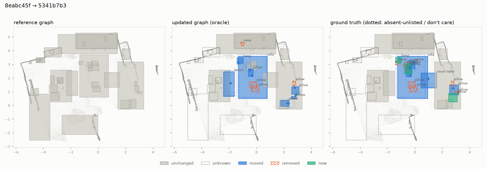
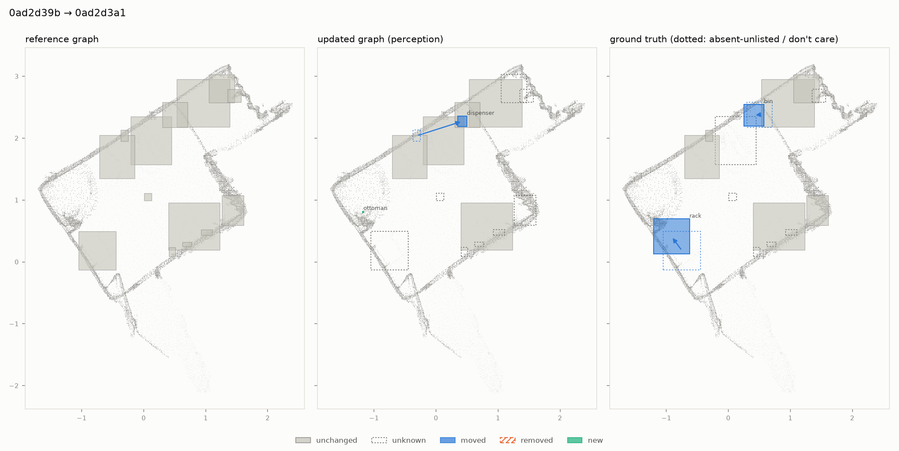
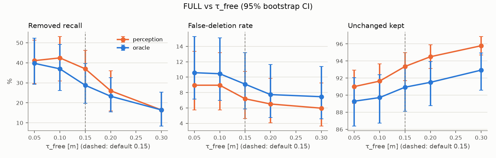
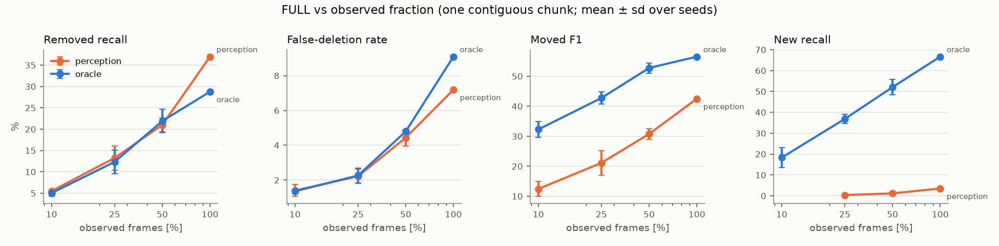

# Living Scene Graphs, Subproject D — change detection and graph maintenance on 3RScan

*Erik Sedlák, November 2026. Code, spec and decision log: this repository ([README](../README.md),
[DESIGN](DESIGN.md), [DECISIONS](DECISIONS.md)). All numbers are on the 3RScan validation split (110
reference → rescan pairs, 47 rooms), reported once; every threshold was tuned on 3 training pairs only.*

## 1. Problem and framing

A scene graph built from one visit to a room goes stale: chairs move, cups disappear, a bag appears. We are
given the graph of a **reference** scan (objects with boxes and support relations such as "pillow *on* sofa"),
the reference mesh and its texture, and the RGB-D frames, camera poses and alignment `T_align` of a later
**rescan**. The task is to maintain the graph:
- give every reference node a state: `unchanged`, `moved`, `removed` or `unknown`;
- add `new` nodes;
- recompute the relations of whatever changed;
- attach a confidence and `last_seen` to each node.

The central difficulty is telling **"gone" from "not seen"**. A rescan typically covers only part of the
room. In the validation split, 737 reference objects are absent from the rescan annotation *without* being
listed as removed (only 73 scored objects are listed removed). A method that deletes whatever it did not see
destroys most of the graph.

**Two observation modes** behind one interface (`ObsSource`):
- **perception** (headline): the method finds rescan objects itself, from depth and appearance residuals against
  the rendered reference, and names them zero-shot with CLIP. It never reads rescan annotations; an AST import
  test enforces this.
- **oracle** (upper bound): rescan objects are the rescan's GT instances (masks, points, labels), with IDs
  shuffled. It isolates the change logic and measures what perception costs.

Every results table has both rows. We do not compete with class-agnostic point-level change detection: candidates
are a means to object-level graph maintenance, and they are evaluated only through the graph metrics.

## 2. Data and what the ground truth really says

3RScan lists per rescan which reference objects moved (`rigid`, with a transform), were removed, or deformed
(`nonrigid`). New objects are rescan IDs not in the reference. Checking these lists against the data before
building anything changed the evaluation:

- **Absent ≠ removed.** 1,018 reference objects of val are missing from their rescan's annotation, but only 96
  are listed removed. They are scored separately as **absent-unlisted**. Deleting one counts as a
  *false deletion*: lower is better, though some of them are real, unlisted removals (§6).
- **Many moves are tiny.** 134 of 370 val moves are shorter than 10 cm (median 17 cm). Moves below
  τ_eval_move = 0.10 m are *don't care*, which leaves 235 scored moves.
- **"New" is noisy.** There are 224 raw new IDs, of which 171 are things / furniture; structure is dropped.
- **Relation changes are rare and mostly annotation gaps.** Of 278 moved things in val, only 4 swap their support
  parent: 7 *gain* a parent that the reference never annotated, and 1 loses one. "Cup moves from table to shelf"
  is rare in 3RScan; most changes are furniture rearrangement. Relation updates are therefore also evaluated on a
  separate set of 40 training pairs with the most parent changes (*relchange*, 73 events, never tuned on).
- **Doors** (12 swings in val) are articulation, which is out of scope. Doors are structure and not scored.
- Conventions verified on data: metres everywhere; `T_align` maps rescan → reference; `rigid` transforms map
  reference → rescan frame (so the motion in the reference frame is `T_align · T_rigid`); depth is big-endian.
  The 3RScan FAQ's "mm" is wrong for `3RScan.json`.

**GT support on val:** 235 moved, 73 removed, 171 new, 1,401 unchanged, 737 absent-unlisted (things + anchors).

## 3. Method

Rescan frames are processed **online, in time order** (stride 3). The reference mesh is rendered (Open3D
ray casting on CPU, ~5 ms per frame) at the rescan pose. The pose comes from `T_align`, refined by a label-free
ICP pre-pass: 1.6–8.4 cm corrections, residual 2 cm.

**Votes from free space only.** Per frame and reference node, compare observed depth d_obs with rendered
depth d_exp on the node's first-hit pixels:
- the vote is **free** (seen *through*) if d_obs > d_exp + τ_free (0.15 m) on ≥ 50% of valid pixels;
- the vote is **seen** if |d_obs − d_exp| ≤ τ_near (0.10 m) on ≥ 50%;
- otherwise it is no information: occlusion, out of view and invalid depth say nothing.

Two refinements make "seen" honest:
- **Seen needs contrast** (FULL): a present pixel counts only if the next reference surface behind the node
  lies more than τ_free behind it. If the node were gone, depth would show it. A pillow on a sofa cannot be seen
  in place by depth, because the sofa is right behind it.
- **Appearance for thin objects** (< 0.15 m): depth cannot see a book or towel vanish. For these nodes the
  reference **texture** is rendered at the rescan pose and compared with the photo using frozen DINOv2 ViT-S/14
  patch features. Distances are taken relative to the frame median, because the rescans are lit differently.
  A thin node's depth vote is replaced by `free-like` (mismatch) or `seen`. Appearance alone never deletes: it
  needs ≥ 3 decorrelated `free-like` votes.

**Viewpoint decorrelation.** A vote counts only if the camera moved ≥ 0.30 m or turned ≥ 20° since the last
counted vote of that kind for that node. A person standing still and filming one spot casts one vote, not 30.

**Deferred commitment.** During the walk, states are tentative (written as snapshots). `removed` and `moved` become
final only at the end, because a moved object can reappear at its new place hundreds of frames after its old
place was seen empty.

**Perception candidates.** Each candidate goes through these steps:
1. Pixels nearer than the rendered reference by > 0.10 m are back-projected.
2. Points near the reference surface or structure are dropped.
3. The rest are accumulated in a 4 cm voxel grid.
4. A voxel is kept only if hit from ≥ 3 decorrelated viewpoints; this removes people, noise and mesh holes.
5. Kept voxels are clustered (connected components), and clusters in door swing regions are dropped.
6. Each cluster is labelled with CLIP ViT-B/32 (top-k over a vocabulary from training-split metadata plus the
   reference labels), from its 5 largest upright crops.

Appearance mismatches lying on support surfaces add thin-object candidates.

**Association and classification** (B2 and FULL), at the end of the sequence:
- *Confirmed in place* (≥ 3 counted seen votes and no free vote): `unchanged`. Such a node absorbs the
  observations lying inside it.
- The rest: a Hungarian assignment on label, size and position, with a hard label gate in oracle mode and a
  soft CLIP term in perception.
- A matched node is `moved` if ICP of the partial observation onto the node's reference points moves its
  centroid by > 0.10 m.
- An unmatched node is `removed` only with **free evidence** (≥ 2 counted free votes); otherwise it is `unknown`.

**Confidence** (FULL): a log-odds score per node:
- it starts at a class prior learned from the training rescans (p_persist, e.g. chair 0.968);
- each counted seen vote adds 2.5 and each free / free-like vote subtracts 2.5;
- a node is deleted only if it has free evidence **and** p < 0.2.

**Relations.** Moved and new things, and things whose parent moved or vanished, are re-checked. A thing keeps its
old parent if that parent still supports it at the new pose. Otherwise geometric contact / containment rules
pick a new parent (an anchor, a thing, or the floor).

| ID | association | removal rule | confidence |
|---|---|---|---|
| B0 | nearest same-label observation | unmatched → removed | – |
| B1 | B0 | online votes, decorrelated, deferred: removed only with free evidence, else unknown | – |
| B2 | confirmed-in-place + Hungarian + ICP moved test | as B1 | – |
| FULL | B2 (+ thin-object candidates) | free evidence **and** p < 0.2; contrastive seen votes; appearance votes for thin nodes | class priors + log-odds |

## 4. Results

> **Note (2026-11-19).** All tables, figures and numbers in this report, including the qualitative figures, are the **M7 method with the strict candidate rules** (every candidate cluster needs 3 decorrelated views) and the learned class priors: ablation row `FULL-m7`. The code now defaults to the relaxed rules of [CHANGE 1](CHANGE_candidate_detection.md) (2 views for small, 1 view for large clusters) and to [CHANGE 2](CHANGE_confidence_unified.md) (2026-11-20: no class prior, l0 = 0 with p_del 0.027; per-voxel candidate log-odds with see-through votes). Their val effect is reported in DECISIONS when measured; a rerun of `lsg m7` replaces the numbers below.

**Change detection on val** (%, micro-averaged over 110 pairs; 95% bootstrap CI over pairs for FULL).

| method | mode | removed P / R | false deletion ↓ | unchanged strict / kept | moved P / R / F1 | new P / R | unknown |
|---|---|---|---|---|---|---|---|
| B0 | oracle | 21.2 / 69.9 | 95.0 | 80.9 / 80.9 | 38.2 / 24.7 / 30.0 | 85.0 / 59.6 | 0 |
| B1 | oracle | 66.0 / 45.2 | 9.5 | 80.9 / 92.9 | 38.2 / 24.7 / 30.0 | 85.0 / 59.6 | 31.6 |
| B2 | oracle | 57.7 / 41.1 | 9.5 | 76.9 / 86.6 | 45.7 / 68.5 / 54.9 | 80.5 / 60.2 | 28.1 |
| **FULL** | oracle | 55.6 [37, 73] / 27.4 [18, 38] | **8.1** [5.1, 12.0] | 76.0 / 86.4 | 45.0 / 69.4 / 54.6 [49, 60] | 81.6 / 59.6 | 29.5 |
| B0 | perception | 4.2 / 91.8 | 95.9 | 2.2 / 2.2 | 22.4 / 8.1 / 11.9 | 3.3 / 12.9 | 0 |
| B1 | perception | 17.7 / 57.5 | 9.4 | 2.2 / 90.4 | 22.4 / 8.1 / 11.9 | 3.3 / 12.9 | 81.2 |
| B2 | perception | 17.7 / 45.2 | 9.5 | 57.9 / 92.7 | 52.9 / 23.0 / 32.0 | 2.4 / 9.4 | 45.3 |
| **FULL** | perception | 24.2 [16, 35] / 32.9 [24, 43] | **7.7** [4.8, 11.4] | 56.2 / **95.3** | 49.1 / 23.4 / 31.7 [24, 39] | 2.0 / 8.8 | 50.2 |

**Support:**
- 73 removed, 737 absent-unlisted, 1,401 unchanged, 235 moved, 171 new;
- "kept" = `unchanged` or `unknown`; `unknown` counts as neither removed nor moved.

**What the table says:**

- **Free-space evidence is the big win.** B0 deletes 95% of the absent-unlisted objects; B1 deletes 9.5%, with the
  same matching. Removed precision rises from 21 to 66% (oracle) and from 4 to 18% (perception).
- **Association + ICP fixes moves.** Oracle moved F1 goes from 30 (B1) to 55% (B2). Recall by displacement is
  55 / 76 / 90% for moves of 0.1–0.3 / 0.3–1 / ≥ 1 m.
- **Confidence trades recall for safety.** FULL keeps the most unchanged objects (perception 95.3%) and has the
  lowest false deletion. Its removed recall is lower than B2's (27 vs 41% oracle), because a GT-removed object that
  also collects seen votes is vetoed. Seen-needs-contrast was introduced *against* this veto, and fixed before any
  further val run. It recovered only ~1 object per mode: the vetoed objects are mostly *really seen* in place.
  The audit (§6) looks at what they are.
- **Perception costs most on `new`** (new P 2.0% vs 81.6% oracle): there are 8.7 candidates per pair, and only
  43% of them correspond to any GT instance (plants, black TV screens, clutter, mesh holes; Fig. 3).
  - Moved F1 halves (32 vs 55%): candidates must be seen from ≥ 3 viewpoints, so small moves whose old and new
    footprints overlap are missed.
  - Perception's *strict* association is low (~3%): unchanged objects produce no depth residual, hence no
    candidate. They are handled by "confirmed in place" instead (unchanged strict 56%).

**Relations** (parent accuracy of things, GT universe; R0 = keep the reference relations, R1 = geometric
rules from scratch, update = ours, FULL):

| set | mode | (a) all things | (b) moved things | (c) parent swapped |
|---|---|---|---|---|
| val | oracle | 92.0 / 79.4 / **92.2** (n = 993) | 94.0 / 64.9 / 85.7 (n = 168) | 0 / 66.7 / 66.7 (n = 3) |
| val | perception | 94.7 / 80.4 / 92.4 (n = 965) | 94.0 / 75.0 / 87.5 (n = 168) | 0 / 66.7 / 66.7 (n = 3) |
| relchange | oracle | 84.4 / 70.3 / 83.4 (n = 441) | 48.4 / 39.8 / 48.4 (n = 93) | 0 / 50.0 / **42.9** (n = 14) |
| relchange | perception | 84.5 / 71.6 / 84.1 (n = 440) | 48.4 / 45.2 / 49.5 (n = 93) | 0 / 28.6 / 21.4 (n = 14) |

- **R0 is a strong baseline on 3RScan.** Most moved things keep their parent, so keeping the old relation is right
  94% of the time on val (b). Ours is level with it on (a) and beats it only where parents really change
  (relchange (c): 43% vs 0%).
- **Keeping a still-supporting parent matters.** Without that rule, val (b) oracle drops from 85.7 to 71.4%.
- Type accuracy (on / in) given the correct parent is 94–97%.
- `next_to` edges are computed (AABB gap ≤ 0.15 m) but provisional and not scored.

## 5. Ablations (FULL, val, both modes; Fig. 4–6)

| switch | oracle: removed P / R, false del. | perception: removed P / R, false del. | other effect |
|---|---|---|---|
| FULL | 55.6 / 27.4 / 8.1 | 24.2 / 32.9 / 7.7 | |
| − appearance (depth only) | 55.6 / 27.4 / 8.1 | 23.5 / 31.5 / 7.9 | only 4 scored GT-removed objects are thin |
| − seen-needs-contrast | 54.3 / 26.0 / 8.1 | 24.0 / 31.5 / 7.7 | ~1 object per mode |
| − class priors (p = 0.9) | 56.4 / 30.1 / 8.4 | 23.7 / 37.0 / 8.0 | |
| − decorrelation | 56.1 / 31.5 / 9.1 | 24.1 / 37.0 / 8.7 | B1: false deletion 9.5 → 10.7 / 9.4 → 10.6 |
| **+ immediate commitment** | 19.6 / 42.5 / 9.5 | 19.6 / 42.5 / 9.5 | oracle moved F1 54.6 → 34.5, new P 81.6 → 50.9 |
| + children follow parent | 55.6 / 27.4 / 8.1 | = FULL | oracle moved F1 54.6 → 53.9 |

- **Deferred commitment is the clearest ablation result.** Deleting a node as soon as its place is seen empty
  deletes objects that merely moved. Their observations at the new place then become false `new` nodes, or are
  taken by another same-label node. Removed precision drops from 56 to 20%, and oracle moved F1 from 55 to 35%.
- **Decorrelation** trades a little recall for fewer false deletions, as expected.
- **Appearance** (the depth vs depth + appearance ablation of the brief) has almost no effect on val, because only
  4 of the 73 scored removals are thin. In the controlled case (a 2 cm book removed from a table, synthetic test)
  depth alone keeps the book and appearance deletes it. On dev it catches a real, unlisted removal (a robot
  vacuum, §6). It is a targeted tool, not an overall gain.
- **τ_free sweep** (0.05–0.30 m) is a monotone trade-off: removed recall 36 → 11% and false deletion 9.4 → 6.6%
  (oracle). The dev-chosen 0.15 m was not changed on val.
- **Observed fraction** (one contiguous chunk of 50 / 25 / 10% of the frames): less observation gives more
  `unknown` (oracle 30 → 77%), *not* more false deletions (8.1 → 1.2%). This is the intended behaviour.

## 6. Ground-truth audit (§7.4)

> **[To be filled after labelling.]** `lsg audit sample` drew, per mode, 10 false-positive `moved`, 10 `removed`
> and 10 `new` predictions of FULL on val (seed 0). The removed / moved pools include absent-unlisted objects. It also
> drew every GT-removed object that B2 deletes but FULL's confidence keeps (the veto set). The run reproduces the M7
> FULL metrics exactly. Each case is a panel: reference photo, rescan photo at the old place, rescan at the
> predicted place, top-down. Erik labelled each case `gt_missing` / `method_error` / `unclear`. Table: share of GT
> gaps per mode and category, with Wilson 95% CIs.

Cases found during development (dev pairs, not part of the sample):
- **r68, robot vacuum** (absent-unlisted): visible in the reference texture, bare floor in the rescan photo. It is
  really gone, the GT does not list it, and only appearance catches it (12 cm high, below depth's reach). It is
  scored as a *false deletion*.
- **r50, pillow** (GT removed): a white pillow lies where a blue-grey one was. Depth sees "something there"
  (23 counted seen votes), and DINOv2, being largely semantic, sees "a pillow where a pillow was". A same-class
  replacement: not caught.
- **r69, shoes** (absent-unlisted): displaced or partly gone; deleted.
- **19eda6f4, pillow 49**: not listed as moved, but its reference and rescan footprints barely overlap
  (IoU 0.14), so it is probably an unlisted move.

## 7. Qualitative results

- **Fig. 1 — a val room with many changes, oracle and perception.**
  - Pair 8eabc45f → 5341b7b3, chosen by rule: the most scored GT changes in the 20-pair milestone subset.
  - Left: the reference graph; middle: the updated graph; right: the GT.
  - Oracle finds the moved sofa, lamp and pillows and the two pillows removed from the sofa. It also moves a
    bench that did not move.
  - Perception also deletes the two removed pillows, but leaves the moved sofa `unknown` and adds several small
    false `new` nodes.

  
  

- **Fig. 2 — the README demo pair** (dev, 0ad2d39b → 0ad2d3a1, perception). The GT has a moved rack and a moved
  bin. Perception gives the bin's new place to a nearby "dispenser" node (a false move), leaves the rack `unknown`,
  and adds one false `new` node ("ottoman"). The oracle run finds the rack move but calls the bin `unchanged` (a 15 cm move; the rack moved 28 cm).

  

- **Fig. 3 — a perception failure case** (4a9a43d2 → 4a9a43d4, chosen by rule: the most perception false
  positives in the subset). Many small candidates are labelled "linen" and match no GT object, and a moved stool
  is deleted instead of moved.

  

- **Fig. 4–6 — ablations, τ_free sweep, observed fraction** (oracle blue, perception orange; 95% CIs).

  
  
  

The **Rerun timeline** (`lsg viz rerun`) replays a pair: the reference mesh, the camera path, and node boxes
coloured by their tentative state at each snapshot, ending with the final graph.

## 8. Limitations, deviations and honesty notes

- **Val was run twice at M5.** The first B2 val run (oracle new R 24.0%, false move 9.8%) exposed reference nodes
  taking GT-new objects of a *different* label through the nyu40 catch-all classes 39 / 40 (keyboard → blanket).
  Excluding them gave new R 60.2% and false move 4.1%. The same run motivated the keep-supporting-parent rule
  (val (b) oracle 72.0 → 86.3%); that rule was checked on dev only. Both runs are reported in DECISIONS.
- **Spec deviations** (all logged in DECISIONS with reasons):
  - confidence step sizes rescaled: with the spec's ±0.4 and the class priors, a node could never reach p_del;
  - thin = 0.15 m (= τ_free) instead of 0.10 m;
  - appearance distances relative to the frame median;
  - a node-level mean appearance vote instead of a per-pixel majority.
- **The confidence veto** costs removed recall (FULL 27–33% vs B2 41–45%). Contrast did not resolve it.
- **Perception association is weak:** about 3% strict, because unchanged objects give no candidates.
- **False candidates:** 8.7 per pair, 43% explained by GT. New precision is 2%.
- **Small moves** (< 0.3 m) are mostly missed in perception, and same-label swaps (two identical chairs) occur.
- **τ_move = 0.10 m** turns ICP noise into small false moves: oracle unchanged kept 86.4% vs B1's 92.9%. τ_move and
  τ_assoc were not swept.
- **Relation types:** the geometric rules confuse `on` / `in`. Anchors carry no support edge. Relation-change
  events are few (val (c) n = 3; relchange n = 14).
- **Out of scope:**
  - articulation (door swings);
  - rotation-only moves;
  - multi-visit chains;
  - a full-frame detector;
  - the optional DINOv2 association term.
- **GT incompleteness** penalises correct detections of unlisted changes; the audit (§6) quantifies this.

## 9. Reproducibility and compute

- Every number comes from `outputs/<run_id>/metrics.json` with the config hash and git SHA. The same config and
  seed give an identical `metrics` block (checked at M2, M3, M5, M7).
- One command produces all tables and plots: `uv run lsg m7` (111 min, 16-core CPU + GTX 1650; DINOv2 / CLIP
  features cached in `cache/`).
- The README reproduces one pair end-to-end in both modes from a clean `uv sync`.
- AI assistance (Claude Code) and per-milestone compute are logged in [AI_USAGE.md](AI_USAGE.md).
