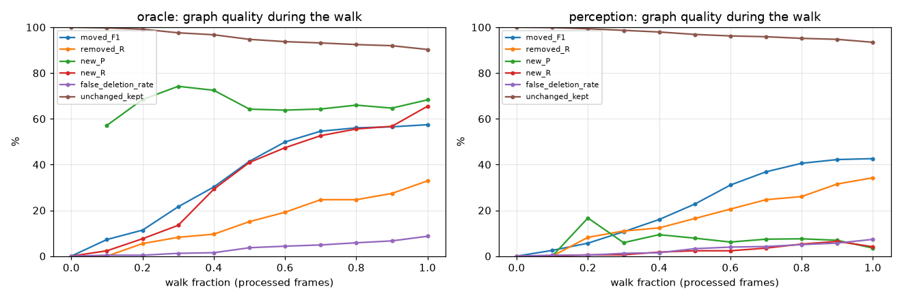
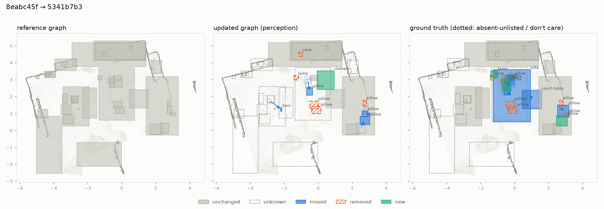
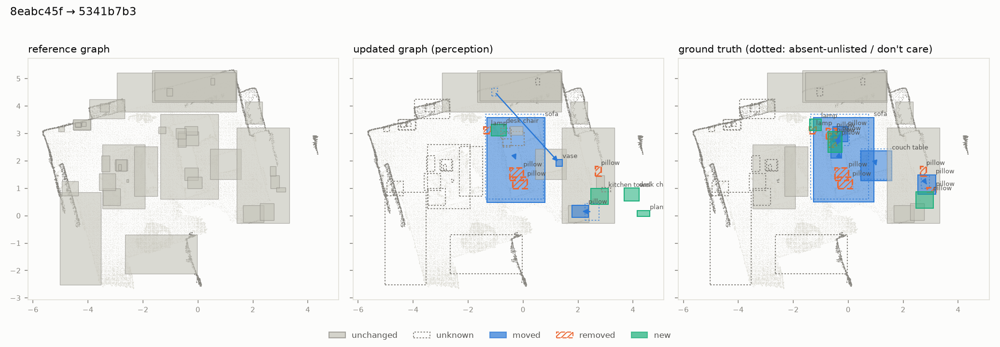
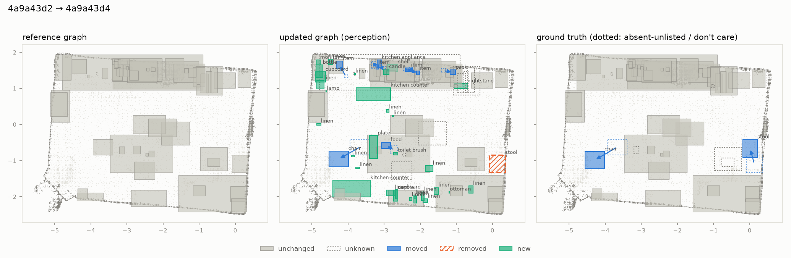
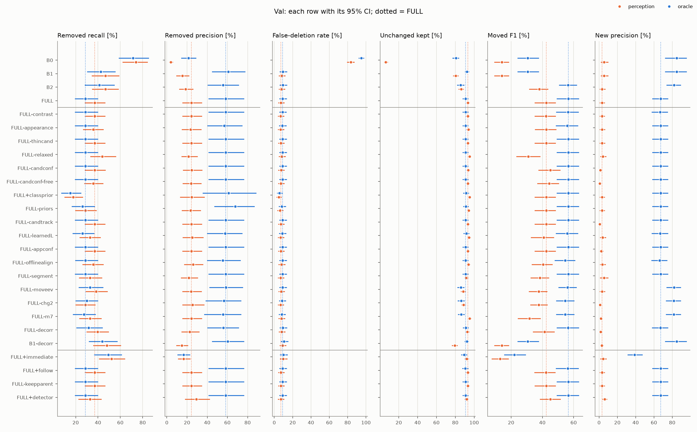

# Living Scene Graphs, Subproject D — change detection and graph maintenance on 3RScan

*Erik Sedlák, November 2026. Code, spec and decision log: this repository ([README](../README.md),
[DESIGN](DESIGN.md), [DECISIONS](DECISIONS.md)). All numbers are on the 3RScan validation split (110
reference → rescan pairs, 47 rooms), from one run of the final method (`outputs/chg3_final`). Thresholds were
chosen on 33 training pairs (`dev_tune`); §8 lists the earlier decisions that val results influenced.*

## 1. Problem and framing

A scene graph built from one visit to a room goes stale: chairs move, cups disappear, a bag appears. We are
given the graph of a **reference** scan (objects with boxes and support relations such as "pillow *on* sofa"),
the reference mesh and its texture, and the RGB-D frames, camera poses and alignment `T_align` of a later
**rescan**. The task is to maintain the graph:
- give every reference node a state: `unchanged`, `moved`, `removed` or `unknown`;
- add `new` nodes;
- recompute the relations of whatever changed;
- attach a confidence and `last_seen` to each node;
- keep the graph up to date *during* the walk, not only at its end.

The central difficulty is telling **"gone" from "not seen"**. A rescan typically covers only part of the
room. In the validation split, 737 reference objects are absent from the rescan annotation *without* being
listed as removed (only 73 scored objects are listed removed). A method that deletes whatever it did not see
destroys most of the graph.

**Two observation modes** behind one interface (`ObsSource`):
- **perception** (headline): the method finds rescan objects itself, from depth and appearance residuals against
  the rendered reference, and names them zero-shot with CLIP. It never reads rescan annotations; an AST import
  test enforces this.
- **oracle** (upper bound): rescan objects are the rescan's GT instances (masks, points, labels), with IDs
  shuffled. It isolates the change logic and measures what perception costs.

Every results table has both rows. We do not compete with class-agnostic point-level change detection: candidates
are a means to object-level graph maintenance, and they are evaluated only through the graph metrics.

## 2. Data and what the ground truth really says

3RScan lists per rescan which reference objects moved (`rigid`, with a transform), were removed, or deformed
(`nonrigid`). New objects are rescan IDs not in the reference. Checking these lists against the data before
building anything changed the evaluation:

- **Absent ≠ removed.** 1,018 reference objects of val are missing from their rescan's annotation, but only 96
  are listed removed. They are scored separately as **absent-unlisted**. Deleting one counts as a
  *false deletion*: lower is better, though some of them are real, unlisted removals (§6).
- **Many moves are tiny.** 134 of 370 val moves are shorter than 10 cm (median 17 cm). Moves below
  τ_eval_move = 0.10 m are *don't care*, which leaves 235 scored moves.
- **"New" is noisy.** There are 224 raw new IDs, of which 171 are things / furniture; structure is dropped.
- **Relation changes are rare and mostly annotation gaps.** Of 278 moved things in val, only 4 swap their support
  parent: 7 *gain* a parent that the reference never annotated, and 1 loses one. "Cup moves from table to shelf"
  is rare in 3RScan; most changes are furniture rearrangement. Relation updates are therefore also evaluated on a
  separate set of 40 training pairs with the most parent changes (*relchange*, 73 events, never tuned on).
- **Doors** (12 swings in val) are articulation, which is out of scope. Doors are structure and not scored.
- Conventions verified on data: metres everywhere; `T_align` maps rescan → reference; `rigid` transforms map
  reference → rescan frame (so the motion in the reference frame is `T_align · T_rigid`); depth is big-endian.
  The 3RScan FAQ's "mm" is wrong for `3RScan.json`.

**GT support on val:** 235 moved, 73 removed, 171 new, 1,401 unchanged, 737 absent-unlisted (things + anchors).

## 3. Method

Rescan frames are processed **online, in time order** (stride 3). The reference mesh is rendered (Open3D
ray casting on CPU, ~5 ms per frame) at the rescan pose given by `T_align`.

**Alignment, online.** 3RScan's `T_align` is about 5 cm off. The method refines it during the walk, from the
frames seen so far only: every 20 processed frames, one label-free point-to-plane ICP registers the depth of
all frames so far (every 10th) to the reference walls, floor and ceiling. It is warm-started from the last
estimate. An estimate is used only if it stays within 20 cm / 5° of the raw transform, rests on ≥ 3 frames,
and is not degenerate (the matched surface normals must span all directions; one wall cannot fix a
translation along it). Until the first accepted estimate the raw transform is used.

**Votes from free space only.** Per frame and reference node, compare observed depth d_obs with rendered
depth d_exp on the node's first-hit pixels:
- the vote is **free** (seen *through*) if d_obs > d_exp + τ_free (0.15 m) on ≥ 50% of valid pixels;
- the vote is **seen** if |d_obs − d_exp| ≤ τ_near (0.10 m) on ≥ 50%;
- otherwise it is no information: occlusion, out of view and invalid depth say nothing.

Two refinements make "seen" honest:
- **Seen needs contrast**: a present pixel counts only if the next reference surface behind the node lies more
  than τ_free behind it. If the node were gone, depth would show it. A pillow on a sofa cannot be seen in
  place by depth, because the sofa is right behind it.
- **Appearance for thin objects** (< 0.15 m): depth cannot see a book or towel vanish. For these nodes the
  reference **texture** is rendered at the rescan pose and compared with the photo using frozen DINOv2 ViT-S/14
  patch features, relative to the frame median (the rescans are lit differently). A thin node's depth vote is
  replaced by `free-like` (mismatch) or `seen`. Appearance alone never deletes: it needs ≥ 3 decorrelated
  `free-like` votes.

**Viewpoint decorrelation.** A vote counts only if the camera moved ≥ 0.30 m or turned ≥ 20° since the last
counted vote of that kind for that node. A person standing still and filming one spot casts one vote, not 30.

**Perception candidates.**
1. Pixels nearer than the rendered reference by > 0.10 m are back-projected; points near the reference
   surface or structure are dropped.
2. The rest are accumulated in a 4 cm voxel grid with a per-voxel log-odds: a decorrelated hit adds 2.5, a
   pixel that sees *through* the voxel subtracts 2.5 (a person who walks away leaves see-through votes
   behind). A voxel is kept at net one decorrelated hit. A second grid at a lower nearer-threshold (5 cm)
   adds large objects: its clusters count only from 40 voxels on.
3. Kept voxels are **co-segmented**: every frame splits its residual pixels into image segments at depth jumps
   and concave creases, and two neighbouring voxels are linked only if no frame that sees both puts them in
   different segments. Plain connected components chained touching objects into one blob (a new sofa with its
   cushions). Clusters in door swing regions are dropped.
4. Each cluster is labelled with CLIP ViT-B/32 (top-k over a vocabulary from training-split metadata plus the
   reference labels) from its 5 largest upright crops.
5. Its **confidence** comes from cluster votes over the whole walk: per frame, the cluster's voxels vote seen /
   free by the node rule, decorrelated; p = sigmoid(0.01 · seen − 0.52 · free). A candidate becomes a `new`
   node only if p ≥ 0.5175 (≥ 7 decorrelated cluster views and no see-through vote); below it, it can still
   explain a move.

Appearance mismatches lying on support surfaces add thin-object candidates, with the same confidence rule.

**Association and classification** (B2 and FULL), at the end of the sequence:
- *Confirmed in place* (≥ 3 counted seen votes and no free vote): `unchanged`. Such a node absorbs the
  observations lying inside it.
- The rest: a Hungarian assignment on label, size and position, with a hard label gate in oracle mode and a
  soft CLIP term in perception.
- **A move needs evidence at the old place** (FULL): a node whose old place is net-seen (more weighted seen than
  free evidence) or never observed may only be matched to an observation inside its own place. It is the mirror
  of the removal rule: an object is not moved away from a place where the sensor keeps seeing it, nor from one
  never looked at.
- A matched node is `moved` if ICP of the partial observation onto the node's reference points moves its
  centroid by > 0.10 m (0.2 m for a net-seen node).
- An unmatched node is `removed` only with **free evidence** (≥ 2 counted free votes); otherwise it is `unknown`.

**Confidence** (FULL): one log-odds scale for every node, with weights measured, not chosen:
- every reference node starts at p = 0.9 (no class prior);
- the vote weights are likelihood ratios measured on the tuning set (counted votes of GT-unchanged vs
  GT-removed objects): a seen vote adds 0.63, a free vote subtracts 1.47, a free-like vote 2.5;
- a node is deleted only if it has free evidence **and** p < 0.4 (2 free votes delete; 1 seen + 2 free do not).

**The graph during the walk.** Every 20 processed frames the same method (association, ICP, states,
relations, confidence) runs on the current state and writes a tentative graph. Candidates keep their ids
across these snapshots by voxel overlap. States stay tentative: `removed` and `moved` become final only at the
end (**deferred commitment**), because a moved object can reappear at its new place hundreds of frames after
its old place was seen empty. The last snapshot is the final graph.

**Relations.** Moved and new things, and things whose parent moved or vanished, are re-checked. A thing keeps its
old parent if that parent still supports it at the new pose. Otherwise geometric contact / containment rules
pick a new parent (an anchor, a thing, or the floor).

| ID | association | removal rule | confidence |
|---|---|---|---|
| B0 | nearest same-label observation | unmatched → removed | – |
| B1 | B0 | online votes, decorrelated, deferred: removed only with free evidence, else unknown | – |
| B2 | confirmed-in-place + Hungarian + ICP moved test | as B1 | – |
| FULL | B2 + old-place evidence for moves (+ thin-object candidates) | free evidence **and** p < 0.4; contrastive seen votes; appearance votes for thin nodes | measured log-odds weights, flat start 0.9 |

**Tuning.** Every threshold was chosen on `dev_tune` (33 training pairs: the 20 rooms with the most changes,
10 random rooms and the 3 original dev pairs; 82 removed, 102 moved, 212 new objects), each sweep with its
selection rule written down before the run (DECISIONS). Val was run once for the tables below.

**Open-vocabulary detector (ablation, CHANGE 3 Part E).** As an alternative to the depth-residual candidates,
Grounding DINO (tiny) proposes boxes on every 2nd processed frame, prompted with the same vocabulary, and SAM 2
cuts each box into a mask. Masks become 3D points (depth, aligned pose), and detections are fused across frames
into tracks by voxel overlap. A track becomes a `new` node only if most of it lies off the reference mesh
(newness ≥ 0.5); otherwise it is an observation of an existing object, handled by the association like an
oracle instance. On the tuning set it raised perception new F1 from 5 to 17 %, but removed F1 fell from 40 to 34 %
(6.2 points; the rule's guard allows 2), so it is not the default; it is reported as the row `FULL+detector`.

## 4. Results

**Change detection on val** (%, micro-averaged over 110 pairs; 95% bootstrap CI over pairs for FULL).
New P / R is given twice: **labelled** (§5 rule: the label must match) and **class-agnostic** (any label).

| method | mode | removed P / R | false deletion ↓ | unchanged strict / kept | moved P / R / F1 | new P / R | new P / R, any label | unknown |
|---|---|---|---|---|---|---|---|---|
| B0 | oracle | 21.1 / 69.9 | 95.0 | 80.8 / 80.8 | 39.1 / 26.0 / 31.2 | 85.0 / 59.6 | 85.0 / 59.6 | 0 |
| B1 | oracle | 65.3 / 43.8 | 9.1 | 80.8 / 92.8 | 39.1 / 26.0 / 31.2 | 85.0 / 59.6 | 85.0 / 59.6 | 31.8 |
| B2 | oracle | 59.6 / 42.5 | 9.1 | 76.2 / 85.8 | 45.6 / 71.9 / 55.8 | 81.0 / 59.6 | 81.0 / 59.6 | 28.4 |
| **FULL** | oracle | 58.5 [43, 75] / 32.9 [24, 45] | **8.7** [5.7, 12.5] | 78.6 / **90.3** | 51.9 / 64.3 / **57.4** [50, 64] | 68.3 / 65.5 | 68.3 / 65.5 | 31.3 |
| B0 | perception | 3.9 / 72.6 | 83.6 | 6.3 / 6.3 | 12.3 / 12.3 / 12.3 | 5.8 / 8.2 | 7.6 / 10.5 | 0 |
| B1 | perception | 14.7 / 45.2 | 7.9 | 6.3 / 80.7 | 12.3 / 12.3 / 12.3 | 5.8 / 8.2 | 7.6 / 10.5 | 69.7 |
| B2 | perception | 17.3 / 43.8 | 8.0 | 55.3 / 86.2 | 40.3 / 37.0 / 38.6 | 3.3 / 3.5 | 5.6 / 5.8 | 42.2 |
| **FULL** | perception | 22.3 [15, 32] / 34.2 [26, 43] | **7.3** [4.7, 10.9] | 54.7 / **93.4** | 54.7 / 34.9 / **42.6** [36, 49] | 3.5 / 4.1 | 5.6 / 6.4 | 49.4 |
| FULL+detector | perception | 28.9 / 32.9 | 6.9 | 59.5 / 91.9 | 48.5 / 41.7 / 44.9 | 6.2 / 21.6 | 10.1 / 35.1 | 44.5 |

**Support:**
- 73 removed, 737 absent-unlisted, 1,401 unchanged, 235 moved, 171 new;
- "kept" = `unchanged` or `unknown`; `unknown` counts as neither removed nor moved.

**What the table says:**

- **Free-space evidence is the big win.** B0 deletes 95% of the absent-unlisted objects; B1 deletes 9.1% (oracle)
  and 7.9% (perception), with the same matching. Removed precision rises from 21 to 65% (oracle) and from 4 to
  15% (perception).
- **Association + ICP fixes moves; old-place evidence makes them safe.** Oracle moved F1 goes from 31 (B1) to 56%
  (B2). FULL keeps that F1 (57%) but nearly halves the false moves of absent-unlisted objects (oracle 4.3 → 2.3%,
  perception 6.4 → 3.7%) and keeps more unchanged objects (oracle 85.8 → 90.3%), because a node whose old place
  the sensor still sees, or never saw, is not moved away. The price is recall on large moves whose old place was
  never observed (oracle ≥ 1 m: 86.8 → 68.4%). Recall by displacement (oracle FULL): 54 / 76 / 68% for moves of
  0.1–0.3 / 0.3–1 / ≥ 1 m.
- **Confidence trades recall for safety.** FULL keeps more unchanged objects than B2 (oracle 90.3 vs 85.8%,
  perception 93.4 vs 86.2%). Its removed recall is lower than B2's (33 vs 43% in oracle, 34 vs 44% in
  perception): a GT-removed object that also collects seen votes is kept.
  Measured vote weights (a seen vote counts 0.63, a free vote 1.47) made this veto weaker than the hand-set ones
  (perception removed R 30.1 → 34.2% against the row `FULL-learnedL`).
- **Perception costs most on `new`.** With depth residuals, perception finds 7 of 171 GT new objects with the
  right label (11 with any label). The detector row finds 37 (60 with any label), at 6 / 10% precision. §8
  explains where the residual candidates lose them.
- **Moves in perception** improved most over the M7 method (moved F1 31.7 → 42.6, row `FULL-m7` in §5), but
  small moves and same-label swaps stay hard (perception moved R 33–38% in every displacement bucket).
- Perception's *strict* association is low (5%): unchanged objects produce no depth residual, hence no candidate.
  They are handled by "confirmed in place" instead (unchanged strict 55%). With the detector, unchanged objects
  are observed too and strict association rises to 13.5%.

**The graph during the walk** (`lsg anytime`, val, FULL; the method runs on the state every 20 processed
frames; walk fraction 30 / 50 / 100%; the last snapshot is the final graph, so 100% equals the FULL row above):
- Perception moved F1 is 10.6 / 22.7 / 42.6%, removed recall 11.0 / 16.4 / 34.2%, false deletion 1.2 / 3.3 /
  7.3% and unchanged kept 98.6 / 96.9 / 93.4%. Oracle moved F1 is 21.6 / 41.4 / 57.4%. The graph starts
  conservative (mostly `unknown`) and gains recall as evidence accumulates; false deletions grow with it.
- **Stability:** 52% of the 2,730 reference nodes change state at least once during the walk in perception
  (67% in oracle; mean 0.59 and 0.74 changes). The median node settles at 36% of the walk (unchanged), 44%
  (removed) and 56% (moved): moved nodes need the late view of their new place, which is why `moved` is final
  only at the end.
- **New objects:** perception new precision is highest early (16.7% at 20% of the walk, with recall below 1%)
  and falls to 3.5% as residual candidates accumulate; class-agnostic recall peaks at 8.8% at 90% and ends at
  6.4%, because the last snapshot re-evaluates candidates with the full walk.

**Relations** (parent accuracy of things, GT universe; R0 = keep the reference relations, R1 = geometric
rules from scratch, update = ours, FULL):

| set | mode | (a) all things | (b) moved things | (c) parent swapped |
|---|---|---|---|---|
| val | oracle | 91.8 / 79.8 / **92.8** (n = 996) | 94.0 / 66.7 / 86.9 (n = 168) | 0 / 100 / 100 (n = 3) |
| val | perception | 94.9 / 79.8 / 92.2 (n = 963) | 94.0 / 69.6 / 85.7 (n = 168) | 0 / 66.7 / 66.7 (n = 3) |
| relchange | oracle | 84.4 / 70.3 / 83.4 (n = 441) | 48.4 / 38.7 / 47.3 (n = 93) | 0 / 42.9 / **35.7** (n = 14) |
| relchange | perception | 84.5 / 71.4 / 83.9 (n = 440) | 48.4 / 45.2 / 49.5 (n = 93) | 0 / 28.6 / 21.4 (n = 14) |

- **R0 is a strong baseline on 3RScan.** Most moved things keep their parent, so keeping the old relation is right
  94% of the time on val (b). Ours is level with it on (a) and beats it only where parents really change
  (relchange (c): 36% vs 0%).
- **Keeping a still-supporting parent matters.** Without that rule, val (b) oracle drops from 86.9 to 75.6%.
- Type accuracy (on / in) given the correct parent is 95–97%.
- `next_to` edges are computed (AABB gap ≤ 0.15 m) but provisional and not scored.

## 5. Ablations (FULL, val, both modes; Fig. 4–6)

Each row switches one part off (−) or on (+); everything else is FULL. Removed R / false deletion / moved F1 per
mode, perception new P / R (labelled).

| row | oracle: rem R / false del. / moved F1 | perception: rem R / false del. / moved F1 | perception new P / R | other effect |
|---|---|---|---|---|
| FULL | 32.9 / 8.7 / 57.4 | 34.2 / 7.3 / 42.6 | 3.5 / 4.1 | |
| − old-place evidence (CHANGE 3 A) | 37.0 / 8.7 / 55.5 | 37.0 / 7.6 / 37.8 | 3.2 / 3.5 | unchanged kept 90.3 → 85.7 / 93.4 → 88.1; false move 2.3 → 4.3 / 3.7 → 6.6 |
| − measured vote weights (C) | 30.1 / 8.1 / 55.6 | 30.1 / 6.9 / 40.1 | 4.9 / 5.8 | |
| − cluster-vote candidate confidence (C) | = FULL | = FULL | 0.8 / 29.2 | any label 1.3 / 48.0 |
| − co-segmentation (N) | = FULL | 34.2 / 6.9 / 38.7 | 4.4 / 2.3 | |
| − online alignment (B: pre-pass over all frames) | 28.8 / 9.0 / 54.6 | 35.6 / 7.9 / 40.4 | 3.6 / 4.1 | |
| + detector (E) | = FULL | 32.9 / 6.9 / 44.9 | 6.2 / 21.6 | any label 10.1 / 35.1 |
| all CHANGE 3 off (= CHANGE 1 + 2) | 30.1 / 8.4 / 54.6 | 28.8 / 6.9 / 37.7 | 0.9 / 14.0 | unchanged kept 86.3 / 88.8 |
| the M7 method (CHANGE 1–3 off) | 27.4 / 8.1 / 54.6 | 32.9 / 7.7 / 31.7 | 2.0 / 8.8 | unchanged kept 86.4 / 95.3 |
| − appearance (depth only) | 32.9 / 8.4 / 57.0 | 32.9 / 7.1 / 42.6 | 3.6 / 4.1 | only 4 scored GT-removed objects are thin |
| − seen-needs-contrast | 32.9 / 8.4 / 56.9 | 34.2 / 7.1 / 42.1 | 3.4 / 4.1 | |
| + class priors (p_del 0.2) | 17.8 / 5.7 / 57.4 | 19.2 / 5.0 / 42.6 | 3.5 / 4.1 | |
| − decorrelation | 34.2 / 9.2 / 57.6 | 37.0 / 8.4 / 42.0 | 2.2 / 6.4 | B1: false deletion 9.1 → 10.4 / 7.9 → 9.1 |
| **+ immediate commitment** | 52.1 / 10.2 / 23.8 | 52.1 / 10.2 / 15.3 | 5.2 / 7.6 | removed P 58.5 → 16.9 / 22.3 → 16.9; oracle new P 68.3 → 37.8 |
| + children follow parent | = FULL / 57.1 | = FULL / 42.4 | | |

- **Deferred commitment is the clearest ablation result.** Deleting a node as soon as its place is seen empty
  deletes objects that merely moved. Their observations at the new place then become false `new` nodes, or are
  taken by another node. Removed precision drops from 58 to 17% (oracle), and oracle moved F1 from 57 to 24%.
- **CHANGE 3 as a whole** (against the row with all its parts off): oracle unchanged kept 86.3 → 90.3% and false
  move 3.8 → 2.3%; perception moved F1 37.7 → 42.6, unchanged kept 88.8 → 93.4%, removed R 28.8 → 34.2%. It
  costs perception new recall (14.0 → 4.1%; precision 0.9 → 3.5%): the candidate confidence threshold chosen on
  the tuning set mostly drops candidates.
- **Online alignment** (no future frames) did not cost on val: perception moved F1 40.4 → 42.6 and false
  deletion 7.9 → 7.3 against the pre-pass, whereas on the tuning set it cost 7.6 points of moved F1 (§8).
- **Appearance** (the depth vs depth + appearance ablation of the brief) has almost no effect on val, because only
  4 of the 73 scored removals are thin. In the controlled case (a 2 cm book removed from a table, synthetic test)
  depth alone keeps the book and appearance deletes it. On dev it catches a real, unlisted removal (a robot
  vacuum, §6). It is a targeted tool, not an overall gain.
- **Decorrelation** trades a little recall for fewer false deletions, as expected.
- **τ_free sweep** (0.05–0.30 m) is a trade-off: removed recall 40 → 15% and false deletion 10.3 → 7.1%
  (oracle; perception 41 → 14%, 8.8 → 5.8%). The 0.15 m chosen on dev was not changed.
- **Observed fraction** (one contiguous chunk of 50 / 25 / 10% of the frames): less observation gives more
  `unknown` (oracle 31 → 78%, perception 49 → 92%), *not* more false deletions (8.7 → 1.4%, 7.3 → 1.4%). This is
  the intended behaviour.

## 6. Ground-truth audit (§7.4)

> **[To be filled after labelling.]** `lsg audit sample` drew, per mode, 10 false-positive `moved`, 10 `removed`
> and 10 `new` predictions of FULL on val (seed 0), from the final run's own FULL row (`outputs/chg3_final/val/FULL`,
> per-object details), so the audited predictions are exactly the reported ones. The removed / moved pools include
> absent-unlisted objects (pool sizes: oracle 157 moved / 81 removed / 52 new; perception 95 / 141 / 194). It also
> drew every GT-removed object that B2 deletes but FULL's confidence keeps (the veto set: 4 oracle, 5 perception).
> Each case is a panel: reference photo, rescan photo at the old place, rescan at the predicted place, top-down.
> Each panel asks one plain question about the world (for example "did this pillow really move?"); Erik answers `yes` / `no` / `unsure`, and the answer is mapped to `gt_missing` (GT incomplete or wrong) / `method_error` / `unclear`. Table: share of GT gaps per mode and category,
> with Wilson 95% CIs.

Cases found during development (dev pairs, not part of the sample):
- **r68, robot vacuum** (absent-unlisted): visible in the reference texture, bare floor in the rescan photo. It is
  really gone, the GT does not list it, and only appearance catches it (12 cm high, below depth's reach). It is
  scored as a *false deletion*.
- **r50, pillow** (GT removed): a white pillow lies where a blue-grey one was. Depth sees "something there", and
  DINOv2, being largely semantic, sees "a pillow where a pillow was". A same-class replacement: not caught.
- **r69, shoes** (absent-unlisted): displaced or partly gone; deleted.
- **19eda6f4, pillow 49**: not listed as moved, but its reference and rescan footprints barely overlap
  (IoU 0.14), so it is probably an unlisted move.
- **Identity audit** (CHANGE 3, 15 oracle cases on the tuning set where a reference node took a different-label GT
  new object): 9 different objects, 3 the same object (GT re-identification), 1 re-ID with the wrong partner,
  2 unclear.

## 7. Qualitative results

- **Fig. 1 — a val room with many changes, oracle and perception.**
  - Pair 8eabc45f → 5341b7b3, chosen by rule: the most scored GT changes in the 20-pair milestone subset.
  - Left: the reference graph; middle: the updated graph; right: the GT.
  - Oracle finds the moved sofa, the two pillows removed from it and several moved pillows. It misses the moved
    couch table, moves a bench the GT does not list, and deletes a vase that is absent but not listed.
  - Perception also deletes the two removed pillows and finds some pillow moves, but leaves the sofa `unknown`,
    moves the lamp to a wrong place and adds two false `new` nodes ("clothes", "table lamp").

  
  

- **Fig. 1b — the same pair with the detector (row `FULL+detector`).** The detector observes the sofa, which is
  now found as moved, and a new object where the GT has a new lamp (labelled "desk chair"); it also adds false
  `new` nodes ("kitchen towel", a second "desk chair", "plant") and moves a vase across the room.

  

- **Fig. 2 — the README demo pair** (dev, 0ad2d39b → 0ad2d3a1, perception). The GT has a moved rack and a moved bin. Perception leaves both
  `unknown` and adds no false node (the M7 method gave the bin's new place to a nearby "dispenser" node and added a
  false `new` node). The oracle run finds the rack move but calls the bin `unchanged` (a 15 cm move; the rack moved
  28 cm).

  

- **Fig. 3 — a perception failure case** (4a9a43d2 → 4a9a43d4, chosen at M7 by rule: the most perception false
  positives in the subset). Large false `new` nodes ("kitchen counter", "linen", "plate") come from residual
  geometry that matches no GT object, and the moved stool is deleted instead of moved; the moved chair is found.

  

- **Fig. 4–6 — ablations, τ_free sweep, observed fraction** (oracle blue, perception orange; 95% CIs).

  
  
  

The **Rerun timeline** (`lsg viz rerun`) replays a pair: the reference mesh, the camera path, and node boxes
coloured by their tentative state at each snapshot (moves and new nodes appear during the walk), ending with the
final graph.

## 8. Limitations, deviations and honesty notes

- **Which decisions val influenced.** Val is meant to be run once. In this project it was looked at between
  development steps, and these decisions followed from val results (all logged in DECISIONS with dates):
  1. **M5:** val was run twice. The first B2 run (oracle new R 24.0%, false move 9.8%) exposed reference nodes
     taking GT-new objects of a *different* label through the nyu40 catch-all classes 39 / 40. Excluding them gave
     new R 60.2%. The same run motivated the keep-supporting-parent rule (checked on dev only).
  2. **M7:** "seen needs contrast" was introduced against the confidence veto seen on val at M6.
  3. **CHANGE 1** (relaxed candidate rules) came from the M7 val new-recall funnel.
  4. **CHANGE 2** Part A (no class prior) came from the `FULL-priors` val row; its defaults were fixed after its
     val run.
  5. **CHANGE 3** came from a logic review after the CHANGE 2 val run (false move 1.6 → 6.4%). From then on every
     choice was made on the tuning set `dev_tune` with a rule written before each run.
  6. **CHANGE 3 Part E** (the detector) was prompted by the first final val run, stopped after 14 rows, which found
     6 of 171 new objects. It was decided on the tuning set and lost its rule; no default changed after that run.
  Before CHANGE 3 (2026-11-20), every threshold was tuned on 3 training pairs only, which is why val became the
  design loop. The tables above are from one run of the final method.
- **Tuning set vs val disagree on two choices.** Online alignment cost perception on the tuning set (moved F1
  −7.6, unchanged kept −2.6 points) and was made the default anyway, by choice (a graph built during the walk may
  not use future frames); on val it is slightly better than the pre-pass. The detector failed its removal guard on
  the tuning set (−6.2 points removed F1), but on val its removed F1 is higher than FULL's (30.8 vs 27.0%). Neither
  choice was revisited after val.
- **Spec deviations** (all logged in DECISIONS with reasons):
  - confidence step sizes measured instead of the spec's ±0.4 (with the spec's values a node could never reach p_del);
  - thin = 0.15 m (= τ_free) instead of 0.10 m;
  - appearance distances relative to the frame median;
  - a node-level mean appearance vote instead of a per-pixel majority.
- **New objects in perception.** On val, 155 of 171 GT new objects are visible in the processed frames (`lsg
  newfunnel`). Only 62 get a residual candidate assigned: 7 become correct new nodes, 36 fall below the
  confidence threshold and 18 are taken by a reference node. The candidates number 56 per pair, of which 29%
  correspond to any GT object (sensor noise at depth edges, reconstruction differences between the two scans,
  people, unannotated clutter). The candidate confidence cannot separate these static artefacts from real objects,
  so any threshold trades recall for precision at new F1 of about 4%. An open-vocabulary detector raises recall (row `FULL+detector`) but
  re-detected objects near an emptied place then take over removed nodes.
- **The confidence veto** costs removed recall (FULL 33–34% vs B2 43–44%).
- **Perception association is weak:** about 5% strict, because unchanged objects give no candidates.
- **Small moves** (< 0.3 m) are mostly missed in perception, and same-label swaps (two identical chairs) occur.
- **τ_move = 0.10 m** turns ICP noise into small false moves; τ_move and τ_assoc were not swept.
- **Relation types:** the geometric rules confuse `on` / `in`. Anchors carry no support edge. Relation-change
  events are few (val (c) n = 3; relchange n = 14).
- **Out of scope:**
  - articulation (door swings);
  - rotation-only moves;
  - multi-visit chains;
  - the optional DINOv2 association term (an identity check with DINOv2 was tried on the tuning set and dropped:
    it separates same-class objects too weakly).
- **Related work, same val split.** Adam et al. (2023, "Has Anything Changed? 3D Change Detection by 2D
  Segmentation Masks") segment changed regions on the same 110 val pairs, offline, by rendering both
  reconstructed meshes and growing depth-difference seeds with SAM masks; they report class-agnostic recall at box
  IoU (R@0.25 = 65.7%) and leave out precision because the GT is incomplete. Their numbers are not comparable to
  the node-level P / R here: they do not associate objects across visits, decide removed vs not seen, or label.
- **GT incompleteness** penalises correct detections of unlisted changes; the audit (§6) quantifies this.

## 9. Reproducibility and compute

- Every number comes from `outputs/<run_id>/metrics.json` with the config hash and git SHA. The same config and
  seed give an identical `metrics` block (checked at M2, M3, M5, M7 and for this run: FULL on one pair twice,
  0 differences).
- One command produces all tables and plots: `uv run lsg m7 --run-id chg3_final` (≈ 4 h, run in two sessions with resume; 16-core CPU + GTX 1650;
  CLIP / DINOv2 features cached in `cache/`). The detector row needs `uv run lsg detect cache --split eval_val`
  first (≈ 2 h on the GPU, once).
- The README reproduces one pair end-to-end in both modes from a clean `uv sync`.
- AI assistance (Claude Code) and per-milestone compute are logged in [AI_USAGE.md](AI_USAGE.md).
